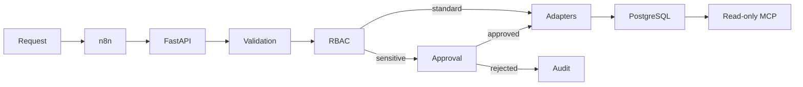

# AccessFlow

AccessFlow is a policy-driven SaaS access orchestrator for employee onboarding,
role changes, and offboarding. It combines FastAPI, Pydantic, PostgreSQL,
SQLAlchemy, Alembic, n8n, Docker, and a read-only MCP server.

The project demonstrates the work commonly found across IT operations,
automation, identity and access management, backend integration, and support
engineering roles without connecting to real company accounts.

## Problem

Access requests handled through messages and spreadsheets create delays,
duplicate work, excessive permissions, retained access after offboarding, and
incomplete audit records.

AccessFlow replaces that informal process with a controlled pipeline:

1. Validate and normalize the incoming request.
2. Calculate access from an explicit RBAC policy.
3. Suppress duplicate webhook events.
4. Pause sensitive access for human approval.
5. Simulate changes through isolated SaaS adapters.
6. Persist every request, decision, result, and audit event.
7. Expose selected read-only information through MCP.

## Architecture



See [the architecture document](docs/architecture.md) for trust boundaries and
the state machine.

## Key capabilities

- Strict Pydantic models reject malformed and system-controlled input.
- Default-deny RBAC covers five employee roles and four applications.
- Sensitive grants derive approval automatically from policy metadata.
- Unique `event_id` values provide database-enforced idempotency.
- Human decisions record reviewer identity and justification.
- Simulated Google Workspace, Slack, Notion, and GitHub adapters are safe by
  design and never change real accounts.
- Ordered audit events make each state transition explainable.
- PostgreSQL is used in Docker; SQLite provides a lightweight local mode.
- Alembic manages the database schema.
- n8n workflow exports provide intake, retry, fallback, and decision routing.
- MCP tools are intentionally read-only.
- GitHub Actions compiles the code, applies the migration, and runs tests.

## Role examples

| Role | Notable access | Approval |
|---|---|---|
| Support Engineer | Support channels and knowledge base | No |
| Automation Engineer | GitHub write on automation repositories | Yes |
| Operations Manager | Private incident channels | Yes |
| Finance Analyst | Private finance resources | Yes |
| HR Specialist | Private employee resources | Yes |

The complete matrix and reasoning are in
[`docs/rbac-policy.md`](docs/rbac-policy.md).

## Quick start: local mode

```powershell
py -m venv .venv
Set-ExecutionPolicy -Scope Process -ExecutionPolicy Bypass
.\.venv\Scripts\Activate.ps1
python -m pip install -r requirements.txt
python -m alembic upgrade head
python -m uvicorn app.main:app --reload
```

Open [Swagger UI](http://127.0.0.1:8000/docs).

## Quick start: Docker and PostgreSQL

```powershell
docker compose up --build
```

The API is available at `http://localhost:8000` and n8n at
`http://localhost:5680`. Copy `.env.example` to `.env` and set private
`POSTGRES_PASSWORD` and `N8N_ENCRYPTION_KEY` values before using the Compose
configuration beyond local demonstration.

## Example: automatic low-risk access

```json
{
  "event_id": "demo-support-001",
  "employee_id": "EMP-2001",
  "employee_name": "Alice Morgan",
  "department": "support",
  "action": "onboard",
  "target_role": "support_engineer",
  "requested_by": "manager@example.test",
  "reason": "New support employee starting on Monday"
}
```

The request completes through the simulated adapters without human approval.

## Example: sensitive access

Submit the same shape with `target_role` set to `automation_engineer`. The API
returns `pending_approval`. Approve it through:

```text
POST /access-requests/{request_id}/decision
```

```json
{
  "decision": "approve",
  "reviewer": "IT Reviewer",
  "comments": "Manager and security approval confirmed"
}
```

The request must include the `X-AccessFlow-Approval-Key` header. Configure its
value through `ACCESSFLOW_APPROVAL_API_KEY`; never commit the real value.

## API surface

| Method | Path | Purpose |
|---|---|---|
| GET | `/health` | Health check |
| POST | `/access-requests` | Validate and submit a request |
| GET | `/access-requests/pending` | List pending approvals |
| GET | `/access-requests/{id}` | Read one request and outcome |
| POST | `/access-requests/{id}/decision` | Approve or reject sensitive access |
| GET | `/access-requests/{id}/audit` | Read ordered audit history |
| GET | `/policies/{role}` | Explain one RBAC policy |

## MCP

The MCP server uses the official Python SDK v2 and exposes:

- `get_access_request`
- `list_pending_approvals`
- `explain_role_access`
- `accessflow://policies/{role}` resource

Run it with:

```powershell
python mcp_server.py
```

To run it against the Compose PostgreSQL database:

```powershell
docker compose --profile mcp up --build
```

This exposes the MCP Streamable HTTP endpoint at
`http://localhost:8001/mcp`. Without the environment override,
`python mcp_server.py` continues to use local stdio transport.

For interactive inspection:

```powershell
mcp dev mcp_server.py
```

No MCP operation can approve requests or alter access. See
[`docs/security.md`](docs/security.md).

## n8n

Import the JSON files in [`n8n-workflows`](n8n-workflows):

- `accessflow-intake.json`
- `accessflow-approval-decision.json`

The workflows expect the API hostname `api` when n8n shares its Docker network.
Change the URL to `host.docker.internal:8000` when n8n runs in a separate local
container on Windows.

## Tests

```powershell
python -m pytest -v
```

The suite covers validation, trust boundaries, RBAC completeness, policy lookup,
idempotency, approval state transitions, rejection, audit history, offboarding,
adapters, API behaviour, and MCP query validation.

## Documentation

- [Architecture](docs/architecture.md)
- [RBAC policy](docs/rbac-policy.md)
- [Security decisions](docs/security.md)
- [Operations runbook](docs/runbook.md)

## Safety boundary

All employees are fictional and all SaaS operations are local simulations. The
repository contains no production credentials and performs no real account or
permission changes.
