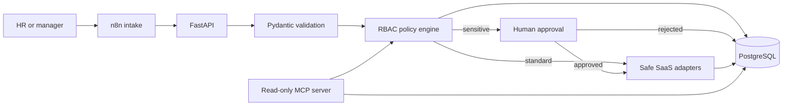
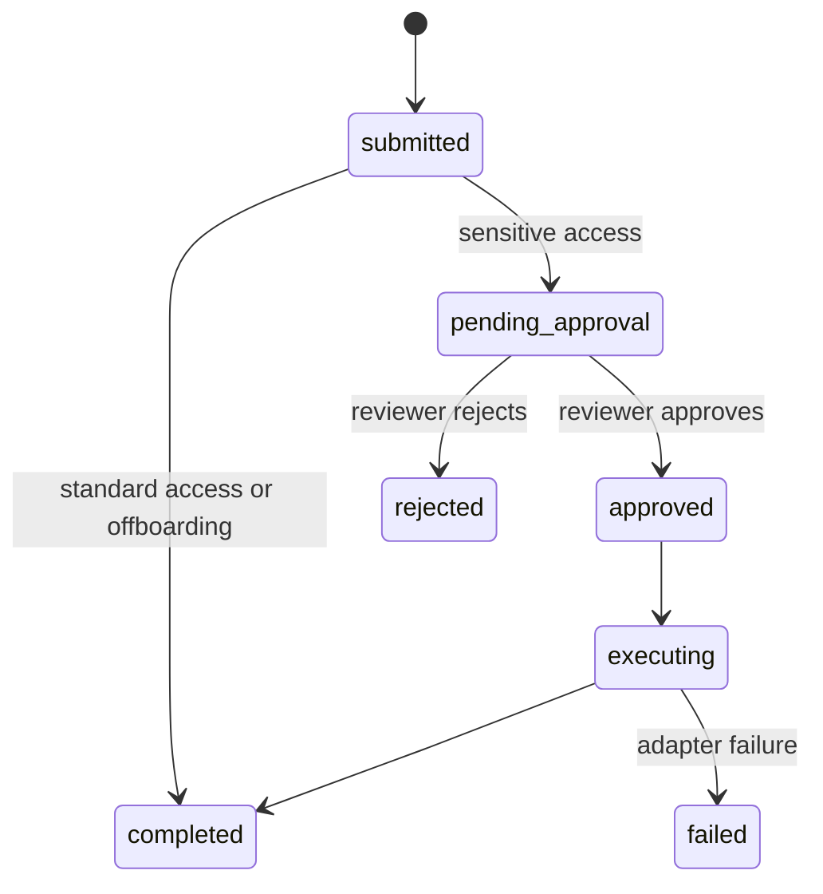

# Architecture

## Trust boundaries

1. Incoming JSON is untrusted and validated with Pydantic.
2. Callers choose a role, never individual application permissions.
3. RBAC policies are explicit and default-deny.
4. Sensitive grants stop at `pending_approval`.
5. Only the HTTP approval endpoint changes approval state; MCP is read-only.
6. SaaS adapters are local simulations and cannot change real accounts.
7. Every policy, approval, and provisioning transition is audited.

## State machine

The current simulated adapters return deterministic successes. The `failed`
state is reserved for replacing them with real integrations.
